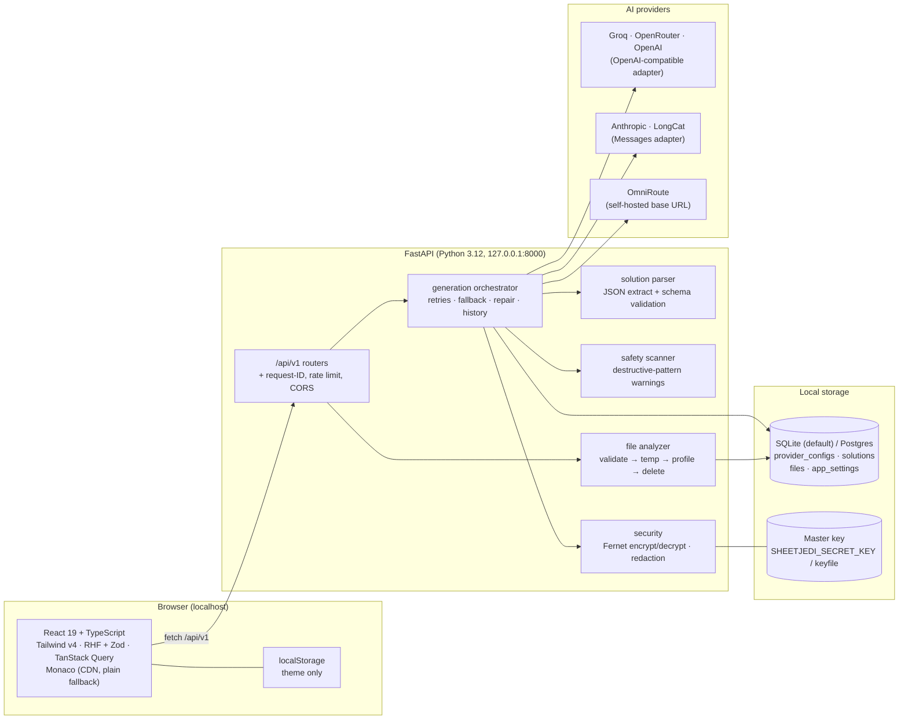
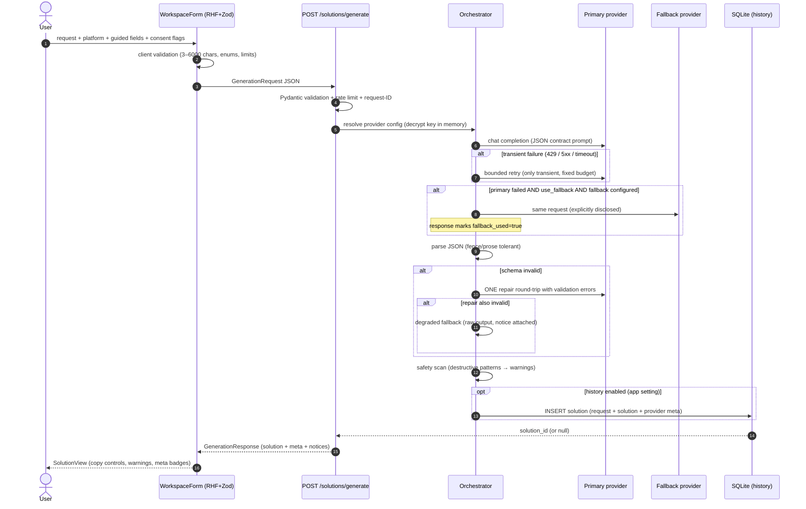
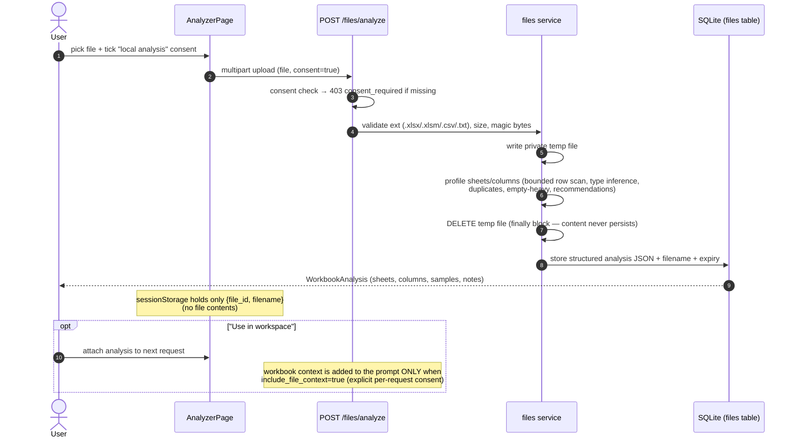
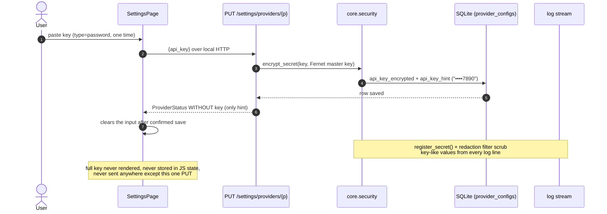
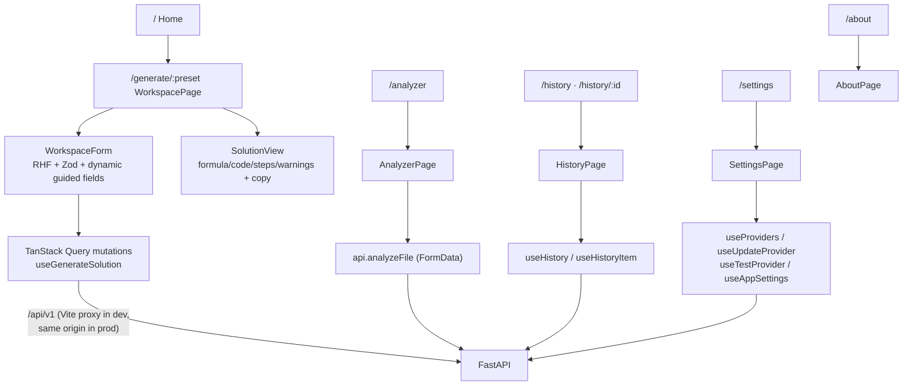
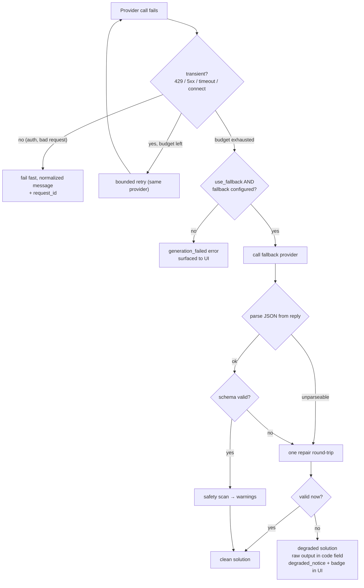

# sheetJEDI — System & Data Flow

Companion to [README.md](README.md). Diagrams use Mermaid (renders on GitHub, VS Code,
Typora, etc.). All claims here are backed by tests listed in [PROGRESS.md](PROGRESS.md).

---

## 1. Component overview

## 2. Generation request lifecycle (non-streaming — the full path)

**Streaming path** (`POST /solutions/stream`, SSE): primary provider only — no fallback, no
repair round-trip; errors stream as a terminal `error` event (decision D-009).

## 3. File analysis (local-only unless consented)

## 4. API key handling (never exposed, never logged)

## 5. Frontend data flow

## 6. Error & degradation model

Every terminal state is visible in the UI: clean, **Fallback used**, **Degraded**, or a
structured error with the backend's exact reason and request ID.
